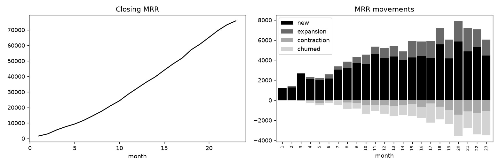

# subscription-metrics

SaaS metrics from monthly MRR snapshots: MRR waterfall, churn, net and gross revenue retention, LTV, quick ratio.

## Task

Compute the numbers a subscription business reports to its board, from nothing but a table of customer, month and MRR.

## Approach

- Customers join, upgrade, downgrade and churn between three plans with plan-specific churn probabilities.
- `mrr_waterfall` splits every month's change into new, expansion, contraction and churned MRR, and the tests check that the parts add up to closing MRR.
- `customer_counts`, `revenue_retention`, `ltv` and `quick_ratio` build on the waterfall.

## Results



- 4,000 customers over time, 2,840 active at the end, closing MRR 75,825.
- Monthly logo churn over the last six months: 4.0%.
- Net revenue retention 97.4%, gross revenue retention 95.2% in the last month.
- ARPU 26.81, simple LTV 666, quick ratio 2.49 (last six months).

## Run

```bash
pip install -r requirements.txt
python run.py      # generates data, runs the analysis, writes reports/
pytest             # unit tests
```

## Layout

```
src/data.py     data generation (fixed seed, no downloads)
src/core.py     analysis / model code
run.py          end-to-end script
tests/          unit tests
reports/        figures and summary.json produced by run.py
```

## Notes

The data is generated by `src/data.py` with a fixed random seed, so the numbers above are reproducible. It is synthetic: it is meant to show the method, and results on real data will differ.

Stack: pandas, matplotlib.
